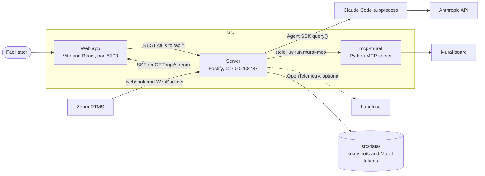
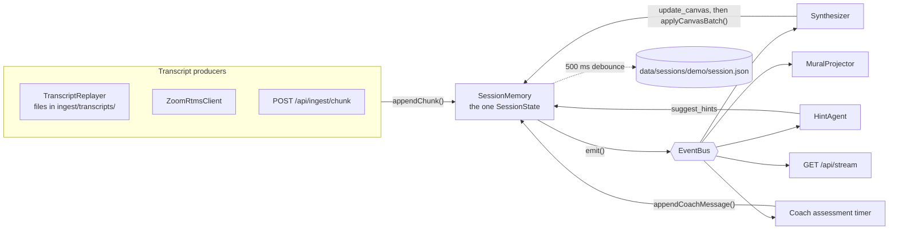
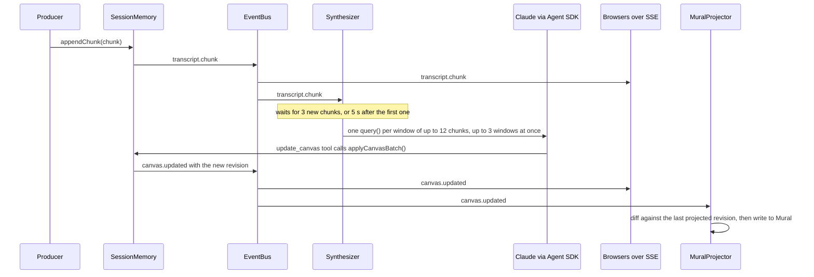
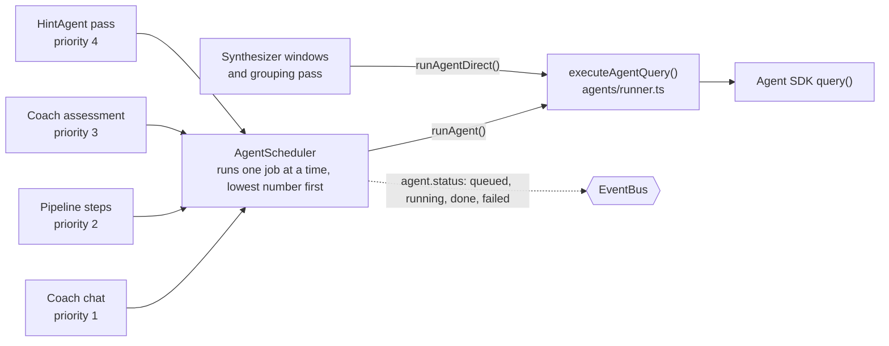
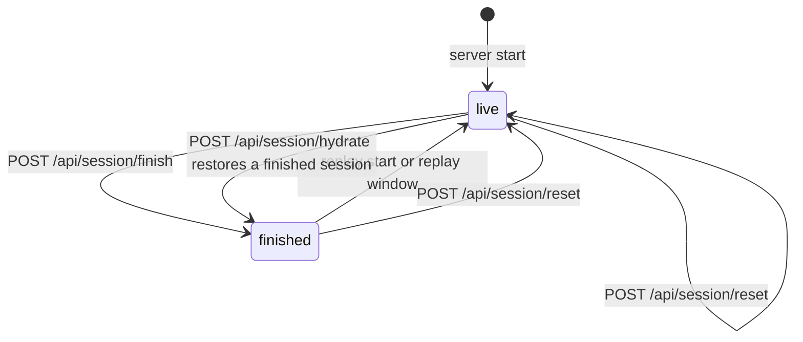
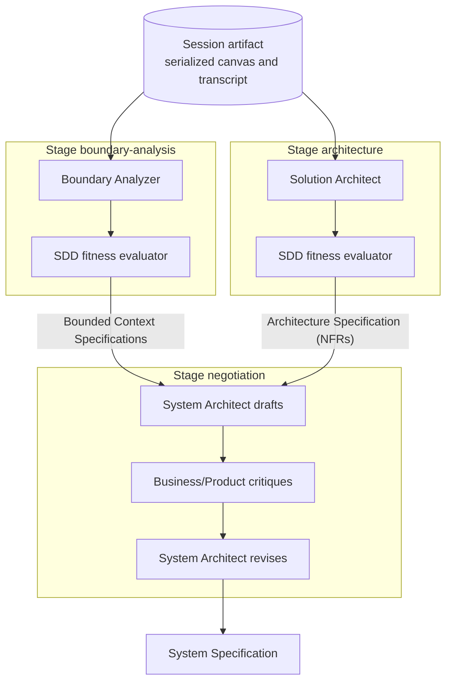
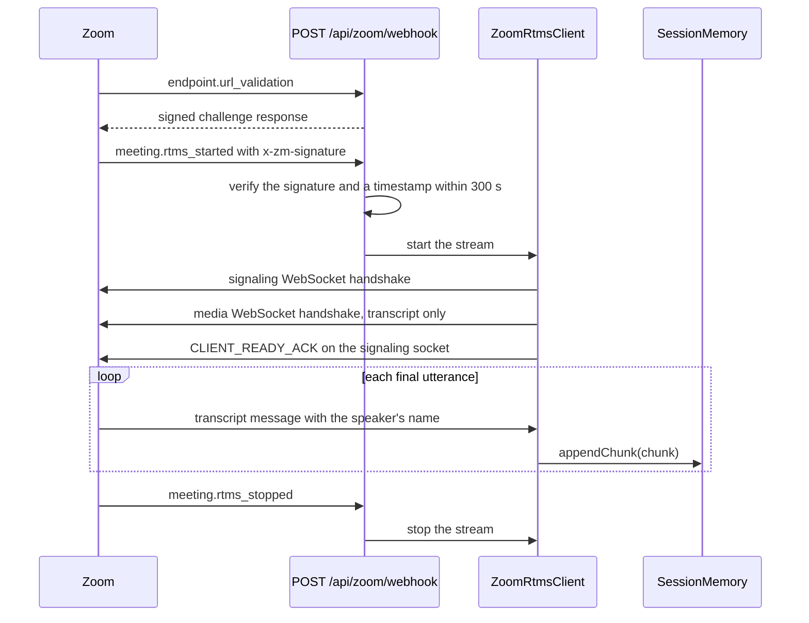
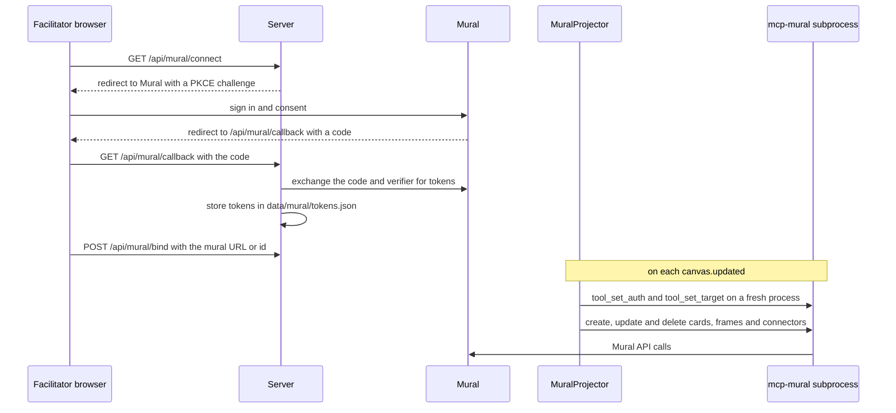

# SpecStorming architecture

**Written:** 2026-11-07, from the working tree at commit `aeb9af2` plus the uncommitted change that
isolates the agents.

The code under `src/` wins where it and this document disagree. `src/CLAUDE.md` holds the
invariants, the commands and the change history, so this document links to it instead of
repeating them.

SpecStorming turns a live EventStorming conversation into a System Specification.

1. A transcript streams into the server, one utterance at a time.
2. Agents built on the Claude Agent SDK model the transcript onto a shared canvas as it arrives.
3. A Coach advises the facilitator during the session.
4. After the session, a pipeline of agents writes the specification from the finished canvas.

## System context

The browser talks to the server in two ways. It sends commands as REST calls, which Vite proxies
from port 5173 to the server. It receives every update over one Server-Sent Events (SSE) stream,
which `packages/web/src/api/useSessionStream.ts` opens. The server reaches Mural through
`mcp-mural`, a Model Context Protocol (MCP) server that the repository vendors.

| External part | Role | Turned on by |
|---|---|---|
| Anthropic API | Runs every agent. The Agent SDK starts a bundled Claude Code subprocess for each `query()`. | A Claude Code login, or `ANTHROPIC_API_KEY` |
| Zoom RTMS (Real-Time Media Streams) | Delivers a live meeting transcript | `ZOOM_RTMS_ENABLED=true` and the `ZOOM_*` credentials |
| Mural | Shows a copy of the canvas on a shared board | `MURAL_CLIENT_ID` and `MURAL_CLIENT_SECRET` |
| Langfuse | Collects a trace for each agent run | `LANGFUSE_*` |

## Inside the server

The server is built around one in-process event bus. Every producer writes to `SessionMemory`,
which emits an event for each change. Every consumer subscribes to the bus.

All paths below are relative to `src/packages/server/src/`.

| Module | Role |
|---|---|
| `index.ts` | Wires every component together and defines every route. |
| `bus/EventBus.ts` | Publishes each `ServerEvent` to every subscriber in the process. |
| `memory/SessionMemory.ts`, `memory/store.ts` | Hold the session state, emit an event for each change, and write the snapshot. |
| `ingest/` | Replays recorded transcripts, verifies Zoom webhooks, and runs the RTMS client. |
| `agents/` | The Synthesizer, the Coach and the HintAgent, plus `scheduler.ts`, `runner.ts` and the MCP tools in `tools/`. |
| `pipeline/` | The spec pipeline, its agents, and a finished-session fixture. |
| `mural/` | OAuth, board layout, the MCP client, and the projector. |
| `observability/tracing.ts` | Loads `src/.env`, and sends spans to Langfuse when its keys are set. |

### Session state and its writers

`SessionState` lives in `packages/shared/src/session.ts`. Each part has one writer, so two agents
never race on the same data.

| Field | Written by |
|---|---|
| `transcript` | The transcript producers, through `appendChunk()`. It only grows. |
| `canvas` | The Synthesizer only, through the `update_canvas` tool and `applyCanvasBatch()`. Each batch bumps `revision` once. |
| `coachChat` | The Coach's replies and assessments, the facilitator's messages, and engaged hints. |
| `hints` | The HintAgent creates hints. `POST /api/hint/:id/dismiss` and `/engage` change their status. |
| `mural` | `MuralProjector` and the startup restore, through `setMuralState()`. It stays empty until a board is bound. |

Spec artifacts are not part of `SessionState`. `PipelineRunner` in `pipeline/orchestrator.ts` holds
them, so a server restart loses them.

## Live synthesis

The pacing constants sit at the top of `agents/SynthesizerAgent.ts`. Each `canvas.updated` event
also refreshes the Coach's quick deterministic score and arms its deeper review. Each new
connection to `GET /api/stream` first receives the current state as catch-up events, and then a
heartbeat every 15 s.

## Agents

### Scheduling

Concurrent `query()` calls can return empty, so most agent runs wait in one queue in
`agents/scheduler.ts`.

The Synthesizer skips the queue, because it runs its windows in parallel and manages that
concurrency itself. So Synthesizer runs emit no `agent.status` events, although `AGENT_PRIORITY`
still lists the Synthesizer at priority 0.

### What each agent sees and can do

Every agent runs on `claude-sonnet-5`. `executeAgentQuery()` gives every agent the same three
guardrails:

1. `settingSources: []`, so no agent loads `CLAUDE.md` files, skills, hooks or settings from disk.
2. `tools: []`, so no agent gets Claude Code's built-in tools, such as Bash and Read.
3. `permissionMode: "dontAsk"`, so a tool call that isn't in the agent's `allowedTools` is denied.

Agent knowledge comes from documents in `src/steering/`, which `loadSteering()` puts into the
system prompt.

| Agent | Steering documents | Tools |
|---|---|---|
| Synthesizer | `eventstorming`, `ddd`. The grouping pass uses `ddd` only. | `mcp__canvas__update_canvas` |
| Coach chat | `eventstorming`, `ddd`, `surface-vagueness`, `surface-assumptions` | None |
| Coach assessment | The Coach chat documents, plus `assess-domain-model` and `domain-model-quality` | None |
| HintAgent | `eventstorming`, `ddd` | `mcp__hints__suggest_hints` |
| Boundary Analyzer | `ddd`, `evolutionary-architecture` | None |
| Solution Architect | `evolutionary-architecture` | None |
| System Architect | `enterprise-architecture`, `evolutionary-architecture` | None |
| Business/Product | `business-goals` | None |
| SDD (spec-driven development) fitness evaluator | Its role prompt only | None |

`src/CLAUDE.md` § "Agents" says when each live agent runs. § "What the agents load" says why the
guardrails exist.

## Session lifecycle

`SessionStatus` has only the two values `live` and `finished`. At startup the server begins an
empty session and restores only the Mural binding from the last snapshot. A hydrate takes the
status of the session it restores, and the committed fixture is finished. Each route below changes
more than the status.

| Route | Effect |
|---|---|
| `POST /api/session/replay/select` | Loads a recorded transcript from `ingest/transcripts/`. |
| `POST /api/session/replay/start` | Sets the status to `live` and starts the replay. Returns 409 while Zoom is connected. |
| `POST /api/session/replay/window` | Replays 30 or 120 seconds of transcript. |
| `POST /api/session/replay/pause` | Pauses the replay. |
| `POST /api/session/finish` | Pauses the replay, stops Zoom, cancels the running synthesis windows, and sets the status to `finished`. |
| `POST /api/pipeline/run` | Pauses the replay, the Synthesizer, the HintAgent and the Coach assessment, and then starts the pipeline. Returns 409 while a run is in progress. |
| `POST /api/session/hydrate` | Restores the last snapshot, or the fixture `pipeline/fixtures/finished-session.json` when no snapshot exists. Suspends the Synthesizer and the HintAgent. |
| `POST /api/session/reset` | Cancels every running agent call, clears the session and the Mural binding, and reloads the default transcript. |

## Spec pipeline

`pipeline/orchestrator.ts` runs the three stages one after another, because concurrent `query()`
calls can return empty. The SDD fitness evaluator appends its assessment to each of the first two
specs. The architecture spec covers the non-functional requirements (NFRs). Each stage change goes out as a `pipeline.status` event, and each
finished spec goes out as `spec.produced`. A session reset abandons the run at the next stage
boundary. `SpecStorming.docx` lists the 12 sections that the System Specification should cover.

## Zoom RTMS ingest

The client is hand-written on `ws` in `ingest/zoom/`. It refuses signaling URLs outside Zoom unless
`ZOOM_RTMS_ALLOW_INSECURE_URLS=true`. After a dropped connection it retries up to 6 times, waiting
from 1 s up to 30 s. Its state reaches browsers as `live.status` events. `src/docs/zoom-rtms-demo.md`
is the setup runbook.

## Mural projection

Mural has no API keys, so the server uses OAuth 2.0 with PKCE (Proof Key for Code Exchange). The
tokens stay on the server. `mural/muralMcp.ts` starts `uv run mural-mcp` over stdio on first use.
A Mural failure marks the projector degraded, and the session carries on without it.
`src/docs/mural-projection.md` is the setup runbook.

## Persistence and observability

- **Snapshot:** `SessionMemory` writes the whole `SessionState` to `data/sessions/demo/session.json`, at most once per 500 ms. A failed write is ignored.
- **Tokens:** `mural/auth.ts` keeps the Mural tokens in `data/mural/tokens.json`. `src/.gitignore` keeps `data/` and `.env` out of commits.
- **Tracing:** `withSpan()` wraps each Coach reply, each Coach assessment and each pipeline run, and the runner records each agent run as a generation. `observability/tracing.ts` exports the spans to Langfuse through OpenTelemetry when the `LANGFUSE_*` keys are set.

## Further reading

- `src/CLAUDE.md` § "Invariants": the rules that the design depends on.
- `src/CLAUDE.md` § "Commands and gotchas": how to build, test and seed a session.
- `src/CLAUDE.md` § "History": why each subsystem exists and which alternatives lost.
