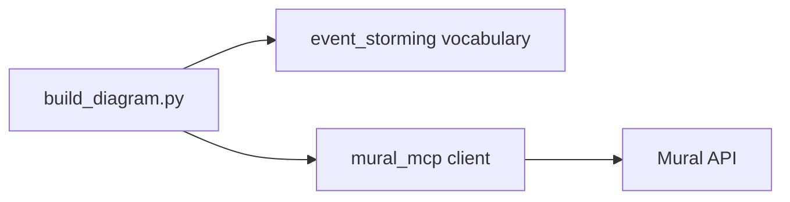

# Mural Event Storming Diagram Builder

Builds an e-commerce flow diagram on a [Mural](https://mural.co) board using Event Storming vocabulary. Domain concepts (`user`, `event`, `important`, `system`) drive card color and size automatically — no hex codes or pixel dimensions in the diagram definition.

## Architecture



- **`build_diagram.py`** — defines cards using only label, concept type, and `[x, y]` position
- **`event_storming/vocabulary.py`** — maps concept enums to colors and card sizes
- **`mural_mcp/`** — handles OAuth2 auth and HTTP calls to the Mural API

## Setup

### 1. Install dependencies

```bash
uv sync
```

### 2. Configure credentials

Copy the example env file and fill in your Mural app credentials:

```bash
cp mural_mcp/.env.example mural_mcp/.env
# edit mural_mcp/.env and set client_id, secret_key, MURAL_ID
```

### 3. Authenticate (one-time)

Run the OAuth2 flow to obtain a `refresh_token`. This opens your browser, asks you to approve access, then writes the token to `mural_mcp/.env` automatically:

```bash
uv run python -m mural_mcp.auth
```

After this step `mural_mcp/.env` should contain `client_id`, `secret_key`, `MURAL_ID`, and `refresh_token`. Tokens are refreshed automatically at runtime — you only need to run this once.

## Run the diagram builder

```bash
uv run python build_diagram.py
```

Each card is created one at a time and logged to the console:

```
Creating 44 cards...
  created: 'User' [user] @ [0, 0]
  created: 'Order Information' [event] @ [200, 0]
  ...
Done. View: https://app.mural.co/t/hackathon0833/m/hackathon0833/1784235982791
```

## MCP Server (Cursor integration)

The MCP server exposes Mural board operations as tools inside Cursor. It is configured in `.cursor/mcp.json` and starts automatically:

```json
{
  "mcpServers": {
    "mural": {
      "command": "uv",
      "args": ["run", "python", "-m", "mural_mcp.server"],
      "cwd": "/Users/wesleyreisz/work/hackathon"
    }
  }
}
```

## Concept vocabulary

Cards are typed using the `Concept` enum. Color and size are derived automatically:

| Concept | Color | Size |
|---|---|---|
| `USER` | yellow | MEDIUM |
| `EVENT` | blue | LARGE |
| `IMPORTANT` | red | MEDIUM |
| `SYSTEM` | pink | MEDIUM |
| `COMMAND` | blue | LARGE |
| `AGGREGATE` | yellow | LARGE |
| `POLICY` | purple | MEDIUM |
| `HOTSPOT` | red | MEDIUM |

Sizes: `LARGE = (150×120 px)`, `MEDIUM = (100×80 px)`, `SMALL = (50×40 px)`
